# HireSphere — System Architecture

**An AI-Powered Career Development and Recruitment Management System**

This document describes the system architecture of HireSphere, derived from the Software Requirements Specification v1.1. It covers the deployment topology, component breakdown, logical data model, key request flows, security model, and non-functional design decisions.

---

## Table of Contents

- [1. Architecture Overview](#1-architecture-overview)
- [2. Deployment Topology](#2-deployment-topology)
- [3. Component Breakdown](#3-component-breakdown)
- [4. Backend Module Structure](#4-backend-module-structure)
- [5. Frontend Structure](#5-frontend-structure)
- [6. Logical Data Model](#6-logical-data-model)
- [7. Key Request Flows](#7-key-request-flows)
- [8. Asynchronous AI Operations](#8-asynchronous-ai-operations)
- [9. Security Architecture](#9-security-architecture)
- [10. Performance and Scalability](#10-performance-and-scalability)
- [11. Reliability and Error Handling](#11-reliability-and-error-handling)
- [12. Privacy and Responsible AI](#12-privacy-and-responsible-ai)
- [13. Technology Decisions and Rationale](#13-technology-decisions-and-rationale)

---

## 1. Architecture Overview

HireSphere uses a **decoupled three-tier architecture**. The first release is a **modular monolith** — not a microservice system — which keeps deployment simple while preserving clean module boundaries for future extraction.

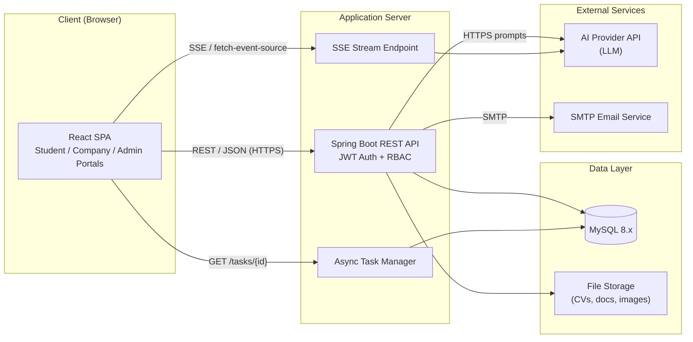

The React SPA runs in the user's browser and communicates with the Spring Boot backend **only** through secured REST APIs (and a Server-Sent Events stream for long AI responses). The backend stores data in MySQL, keeps CV files and company verification documents in file storage (metadata in MySQL), and calls an external AI provider for language-based features.

### Architectural Principles

| Principle | How it is applied |
|---|---|
| **Decoupling** | Frontend and backend communicate only through versioned REST APIs; no shared state. |
| **Modular monolith** | Feature-based modules in one deployable unit, with clean boundaries for future extraction. |
| **Stateless backend** | No session state on the server; JWT carries identity. Async task state lives in MySQL, not in memory (NFR-SCL-01). |
| **Externalised configuration** | The same build artifact runs in development and production; secrets come from the environment (NFR-MNT-04, NFR-SEC-08). |
| **Graceful AI degradation** | AI is an optional layer; all rule-based features work without it (NFR-REL-01). |

---

## 2. Deployment Topology

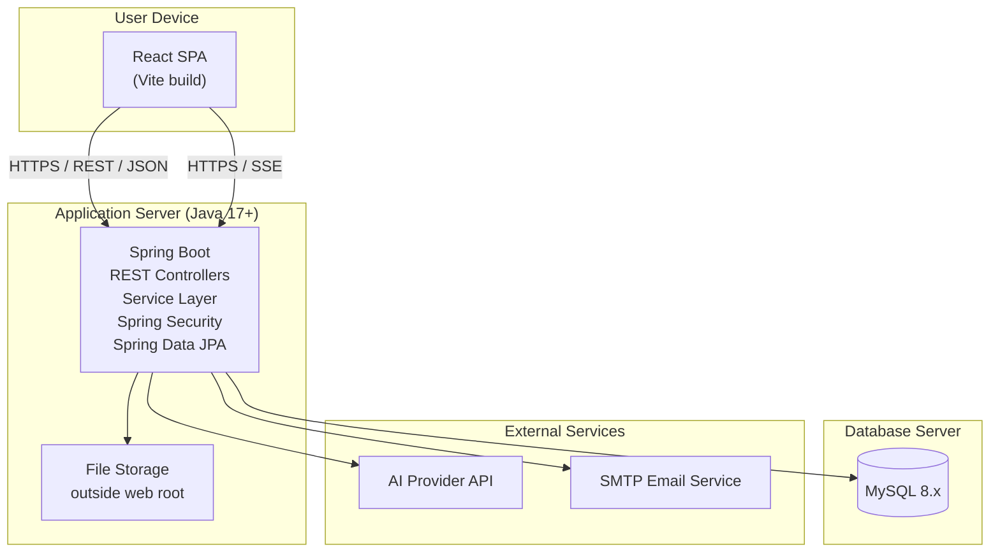

### Environment Requirements

| Component | Requirement |
|---|---|
| Client | Modern web browser — latest two versions of Chrome, Edge, Firefox, and Safari, on desktop, tablet, and mobile |
| Server | Java 17+, Spring Boot, on Windows, Linux, or macOS |
| Database | MySQL 8.x |
| AI service | Provider API reachable over HTTPS (TBD-01) |
| Email | SMTP service for company email verification in the MVP (TBD-03) |

---

## 3. Component Breakdown

### 3.1 Frontend (React SPA)

The frontend is a single-page application built with React and Vite. It renders three role-specific portals (Student, Company, Admin) and enforces route-level access control on the client side — but **server-side authorisation is always the real boundary** (NFR-SEC-03).

| Responsibility | Detail |
|---|---|
| Rendering | Role-specific navigation and pages; unauthorised routes redirect to login or "unauthorised" page (FR-UI-02) |
| Responsive design | Usable from 360 px to 1920 px (FR-UI-01) |
| Theme support | Dark and light themes, remembered across sessions (FR-UI-05, Later) |
| API communication | REST over HTTPS with JSON payloads; `Authorization: Bearer <JWT>` header on every protected request |
| SSE client | fetch-based SSE client (e.g. `@microsoft/fetch-event-source`) because the native `EventSource` cannot send auth headers (NFR-PERF-04f) |
| Async UI pattern | Shows skeleton/progress for long operations; never blocks; rule-based results appear first, AI suggestions load after (NFR-PERF-04d) |
| Task recovery | Can retrieve completed AI results by task ID after a page refresh (NFR-PERF-04e) |

### 3.2 Backend (Spring Boot REST API)

The backend is a modular monolith organised in feature modules, each following the layered pattern: **controller → service → repository → entity → DTO** (NFR-MNT-01).

| Layer | Responsibility |
|---|---|
| **Controller** | Receives REST requests, validates input, enforces RBAC, returns JSON. Documented with OpenAPI (NFR-MNT-02). |
| **Service** | Business logic, transaction management, calls to AI service and file storage. |
| **Repository** | Spring Data JPA / Hibernate data access over JDBC. |
| **Entity** | JPA-mapped domain objects. |
| **DTO** | Request/response objects decoupled from entities. |

### 3.3 External Services

| Service | Purpose | Integration |
|---|---|---|
| AI provider API | CV insights, interview questions and feedback, chatbot responses | HTTPS requests with prompts; API key in environment config; accessed via Spring AI or a provider SDK; responses can be streamed |
| File storage | CV files, company images, company verification documents | Local or cloud storage outside the public web root; MySQL keeps metadata and storage path |
| Document parsing | CV text extraction (PDF in MVP) | Apache PDFBox or Apache Tika |
| Email service (SMTP) | Company email verification link / OTP | Credentials in environment config; provider TBD-03 |

---

## 4. Backend Module Structure

Each module follows the controller → service → repository → entity → DTO layering and maps to a feature group in the SRS traceability matrix.

```mermaid
flowchart TB
    subgraph Backend["Spring Boot Backend"]
        direction TB
        AUTH["auth<br/>Authentication & User Management<br/>FR-AUTH-01–09"]
        STUDENT["student<br/>Student Profiles<br/>FR-STU-01–06"]
        JOB["job<br/>Job Management & Browsing<br/>FR-JOB-01–13"]
        CV["cv<br/>Smart CV Analyzer<br/>FR-CV-01–15"]
        APPLICATION["application<br/>Application Tracker<br/>FR-APP-01–09"]
        ASSESSMENT["assessment<br/>Tests & Practice<br/>FR-TST-01–10"]
        AI["ai<br/>AI Interview & Chatbot<br/>FR-INT-01–09, FR-BOT-01–05"]
        COMPANY["company<br/>Company Profiles & Hiring History<br/>FR-COM-01–08"]
        ANALYTICS["analytics<br/>Dashboards & Analytics<br/>FR-DSH-01–09"]
        NOTIFICATION["notification<br/>Notifications & Follow Priority<br/>FR-NOT-01–10, FR-REC-01–03"]
        ADMIN["admin<br/>Administration & Trust-Safety<br/>FR-ADM-01–15"]
        ASYNC["async-tasks<br/>Async AI Task Manager<br/>NFR-PERF-04a–f"]
    end
```

### Cross-Module Dependencies

| Module | Depends on |
|---|---|
| cv | student (resume), job (job skills), ai (suggestions), async-tasks |
| application | student, job, notification, company |
| ai | async-tasks, student (consent) |
| assessment | job, question_bank (admin) |
| company | application (hiring history), analytics |
| notification | job, student (follows), application (status changes) |
| admin | company (verification), job (moderation), question_bank |

---

## 5. Frontend Structure

```
frontend/src/
├── pages/                # Screen components, organised by portal
│   ├── public/            # Landing, Login, Register, Unauthorised, Not found
│   ├── student/           # Dashboard, CV Analyzer, Jobs, Tracker, Practice,
│   │                      # Mock Interview, Chatbot, Followed Companies, Profile
│   ├── company/           # Dashboard, Manage Jobs, Applicants, Tests,
│   │                      # Company Profile, Hiring History, Verification Docs
│   └── admin/             # Dashboard, Users, Verification, Moderation,
│                          # Reports, Question Bank, Announcements, Audit Log
├── components/           # Shared UI components (forms, tables, badges, skeletons)
├── services/             # API clients — REST + fetch-based SSE
├── context/              # Auth, theme, notification context providers
└── utils/                # Helpers (date formatting, match % display, etc.)
```

---

## 6. Logical Data Model

The database schema is organised around five colour-coded areas. Referential integrity is enforced with foreign keys (DR-01). Schema changes are applied through versioned migration scripts (DR-06).

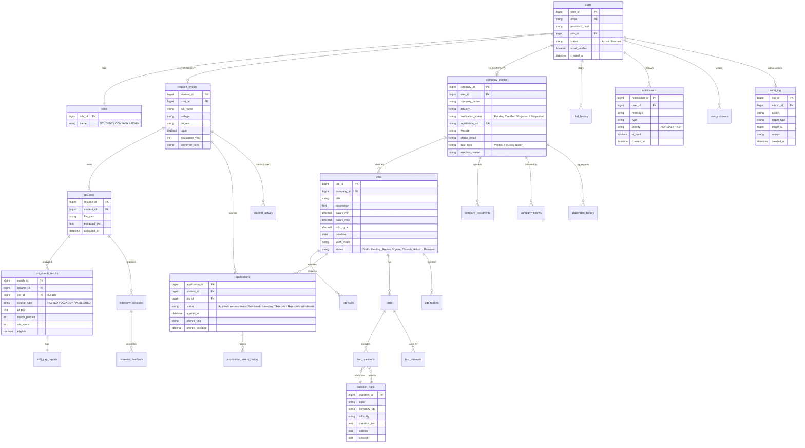

### Principal Entities

| Entity | Key attributes | Notes |
|---|---|---|
| `users` | user_id, email, password_hash, role_id, status, email_verified, created_at | Email unique; status is Active or Inactive only. A company's right to post comes from `company_profiles.verification_status`, not `users.status`. |
| `roles` | role_id, name | STUDENT, COMPANY, ADMIN |
| `student_profiles` | student_id, user_id, full_name, college, degree, cgpa, graduation_year, preferred_roles | One per student user |
| `company_profiles` | company_id, user_id, company_name, industry, verification_status, registration_no, website, official_email, trust_level, rejection_reason | verification_status: Pending / Verified / Rejected / Suspended. registration_no unique. |
| `company_documents` | doc_id, company_id, file_path, type, uploaded_at | Proof documents; file outside web root; visible to owner and administrators only |
| `resumes` | resume_id, student_id, file_path, extracted_text, uploaded_at | File on storage; metadata in MySQL |
| `jobs` | job_id, company_id, title, description, salary_min, salary_max, min_cgpa, deadline, work_mode, status | status: Draft / Pending_Review / Open / Closed / Hidden / Removed |
| `job_skills` | id, job_id, skill_name, is_required | Required or preferred skill |
| `job_match_results` | match_id, resume_id, job_id (nullable), source_type, jd_text, match_percent, ats_score, eligible | job_id empty for pasted JD (Case 1); source_type: PASTED / VACANCY / PUBLISHED |
| `skill_gap_reports` | report_id, match_id, missing_skills, suggestions | One per match result |
| `applications` | application_id, student_id, job_id, status, applied_at, offered_role, offered_package | Unique (student_id, job_id) — a withdrawn job cannot be re-applied. offered_* set only when Selected (LPA). |
| `application_status_history` | id, application_id, status, changed_by, changed_at | Append-only |
| `question_bank` | question_id, topic, company_tag, difficulty, question_text, options, answer | Managed by admin |
| `tests` | test_id, job_id, title, type, duration_minutes | Questions linked via test_questions |
| `test_questions` | test_id, question_id | Many-to-many link between tests and question_bank |
| `test_attempts` | attempt_id, test_id, student_id, score, submitted_at | Answers stored per attempt |
| `interview_sessions` | session_id, student_id, job_id (optional), mode, status | Mock or recruiter session |
| `interview_feedback` | feedback_id, session_id, question, answer, ai_feedback, score | AI output stored as recommendation |
| `chat_history` | chat_id, user_id, role, message, created_at | Per-user conversation |
| `notifications` | notification_id, user_id, message, type, priority, is_read, created_at | In-app notifications; priority NORMAL or HIGH |
| `user_consents` | consent_id, user_id, consent_type, granted_at | Stores AI-use consent (FR-CV-15) |
| `company_follows` | student_id, company_id, priority, created_at | Unique (student_id, company_id); priority High / Normal / Muted |
| `placement_history` | id, company_id, academic_year, hires, avg_package, max_package, source | source: PLATFORM / SELF_REPORTED; aggregated figures only |
| `company_career_paths` | id, company_id, role, level_order, level_title, typical_years | Shown after administrator approval |
| `student_activity` | id, student_id, activity_date, type, points | Unique (student_id, activity_date, type) for login; Later release |
| `job_reports` | report_id, job_id, student_id, reason, status, created_at | One report per student per job; status Open / Upheld / Dismissed |
| `audit_log` | log_id, admin_id, action, target_type, target_id, reason, created_at | Append-only (FR-ADM-07, FR-ADM-13) |

### Data Management Requirements

| ID | Requirement |
|---|---|
| DR-01 | Referential integrity enforced with foreign keys between users, profiles, jobs, applications, and assessment records. |
| DR-02 | Uploaded CVs kept until the student deletes them or the account is deleted; files stored outside the public web root under non-guessable names. |
| DR-03 | A user can request deletion of their account, CVs, chat history, and interview data; retention period for other records TBD-06. |
| DR-04 | Application status history and audit logs are append-only. |
| DR-05 | Database backed up regularly in the deployment environment. |
| DR-06 | Schema changes applied through versioned migration scripts. |
| DR-07 | Company verification documents stored like CVs (outside web root, non-guessable names), retained while the company account exists or the audit period (TBD-06) requires. |
| DR-08 | Offered role and package stored per application but exposed to students only as aggregates in `placement_history` (BR-14). |
| DR-09 | Student activity and points data readable only by the student and administrators; not exposed to companies (BR-12). |

---

## 7. Key Request Flows

### 7.1 Authentication Flow

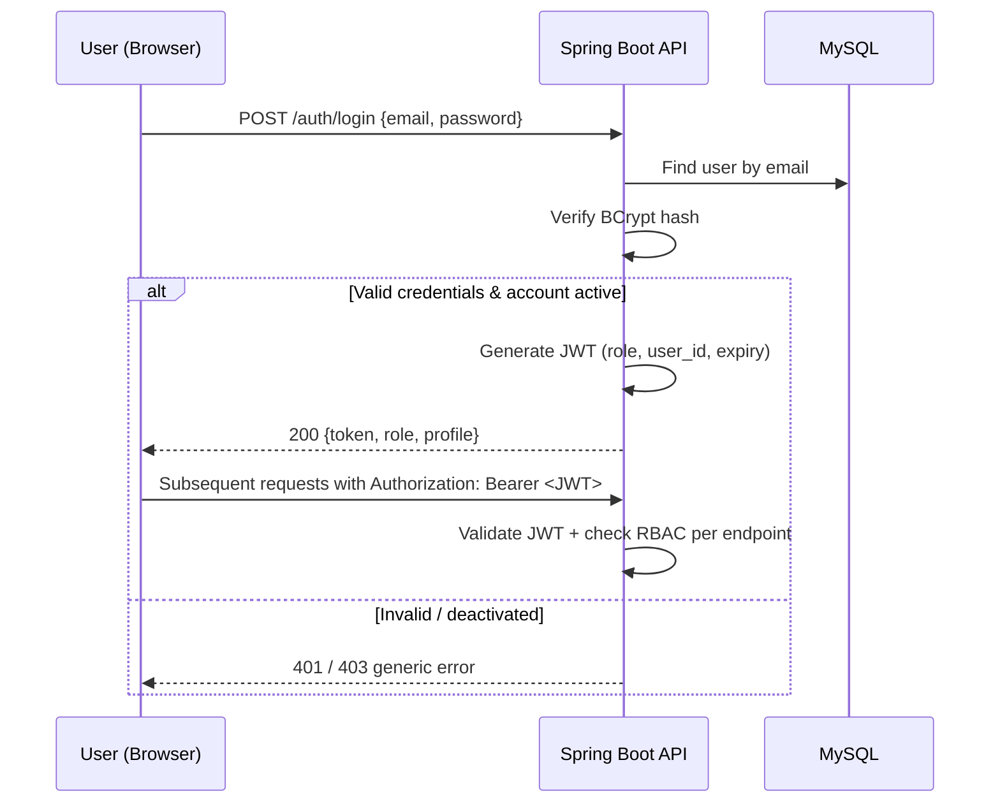

- Passwords are stored only as salted BCrypt hashes and never returned in any response (FR-AUTH-04, NFR-SEC-01).
- JWTs expire (default 24 h, configurable) and are validated on every protected request (NFR-SEC-02).
- RBAC is enforced on the server for every endpoint; hidden UI controls are not the only protection (NFR-SEC-03).
- Repeated failed logins are rate-limited: after 5 failed attempts per email or IP within 15 minutes, further attempts are blocked for 15 minutes (NFR-SEC-09).

### 7.2 Job Posting Flow

```mermaid
sequenceDiagram
    participant C as Company (Verified)
    participant API as Spring Boot API
    participant DB as MySQL
    participant N as Notification Service

    C->>API: POST /jobs {title, skills, eligibility, salary, deadline}
    API->>API: Validate (deadline future, fields present, ≥1 required skill)
    API->>API: Check company verification_status == Verified
    API->>API: Scan job text for scam indicators
    API->>API: Check if one of company's first 3 jobs
    alt Clean & not first-3
        API->>DB: Save job as Open
        API->>N: Notify matching students (FR-REC-01) + followers (FR-NOT-05)
    else Flagged or first-3
        API->>DB: Save job as Pending_Review
        API-->>C: "Awaiting admin review"
        Note over API,DB: Admin approves → Open → notify; removes → notify company with reason
    end
```

### 7.3 CV Analysis Flow (Case 1 — CV + Job Description)

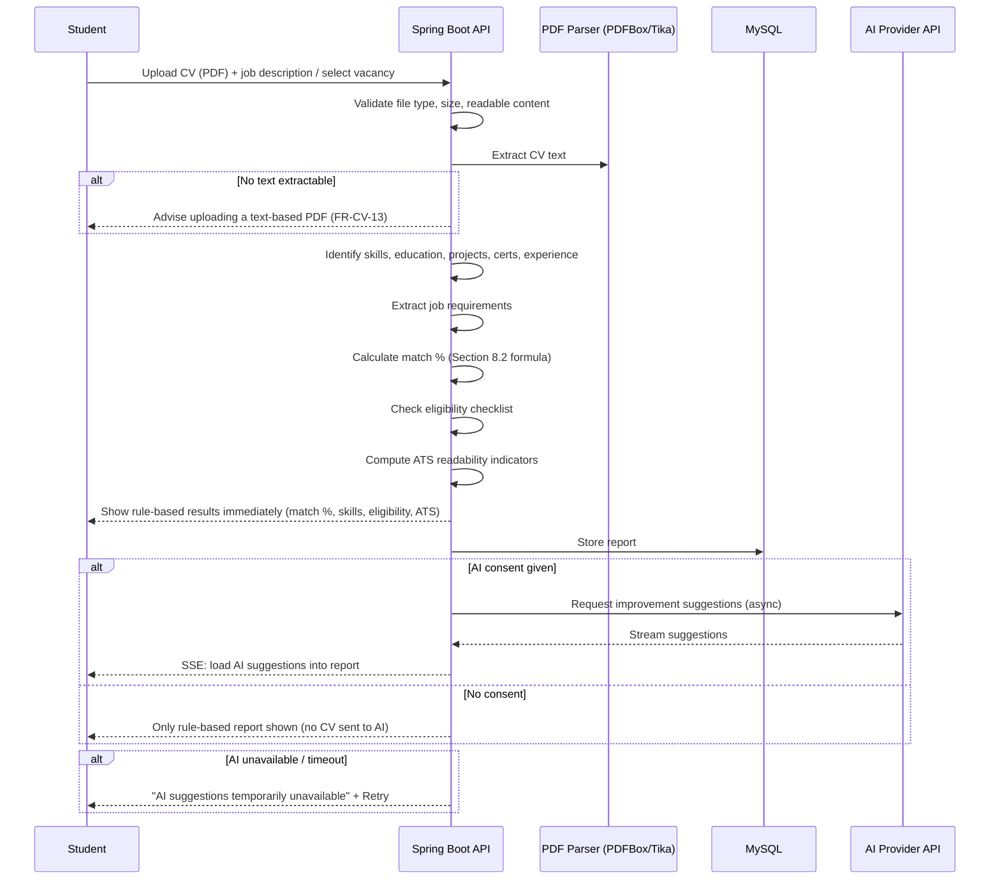

Key properties of this flow:
- Rule-based results (match %, skills, eligibility, ATS) appear **first**, within 5 seconds (NFR-PERF-03).
- AI suggestions load **afterwards**, asynchronously (NFR-PERF-04d).
- The report is saved so the student can view past reports (FR-CV-11).
- Every report states results are indicative and do not guarantee ATS, eligibility, or selection (FR-CV-12).

### 7.4 Application Lifecycle Flow

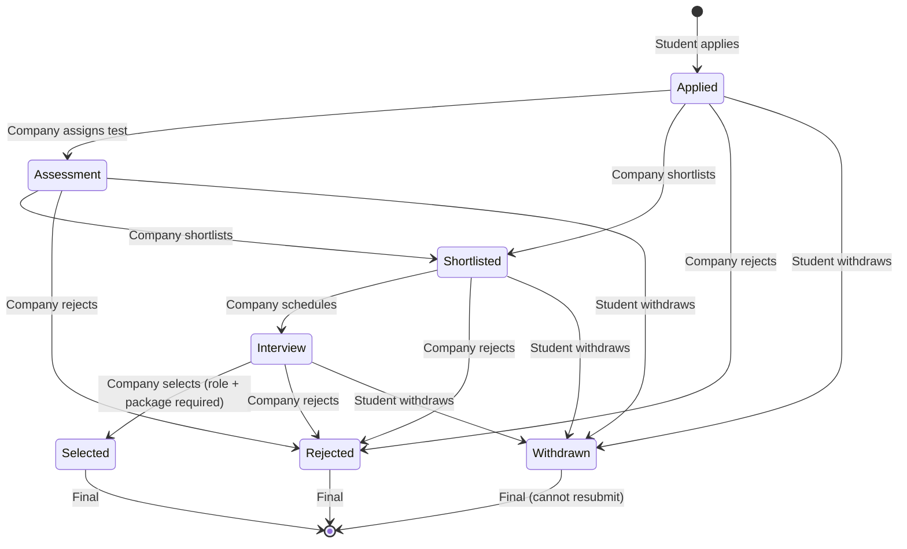

- Every transition is stored in `application_status_history` with time and the user who made it (FR-APP-05).
- A withdrawn application is final and cannot be resubmitted (BR-02, enforced by the unique `(student_id, job_id)` constraint).
- Selecting a candidate requires the offered role and package (FR-COM-05), which feeds the company's platform-verified hiring history.

### 7.5 Company & Job Verification Flow (Layered Protection)

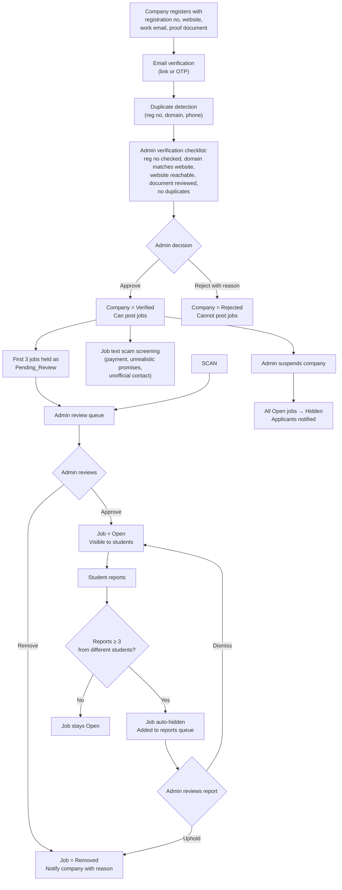

No automated check can fully prove a company is real, so protection is **layered** and ends with **human review**.

---

## 8. Asynchronous AI Operations

Any operation that can take longer than 5 seconds (AI suggestions, interview feedback, chatbot) runs asynchronously. This is the core pattern defined by NFR-PERF-04a through 04f.

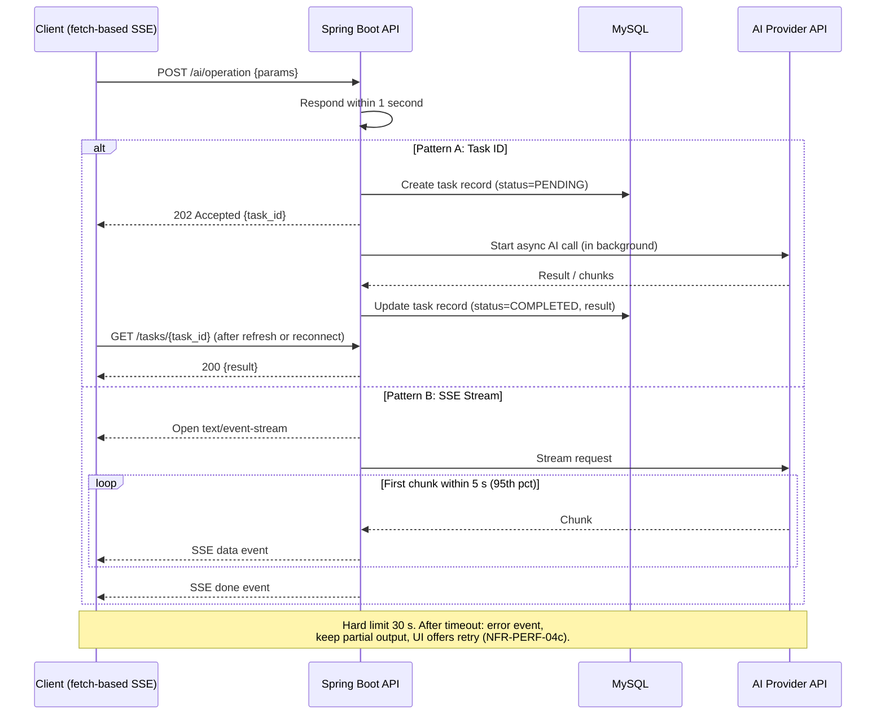

### Async AI Design Rules

| Rule | Requirement | Source |
|---|---|---|
| Non-blocking API | API responds within 1 second, either with `202 Accepted + task_id` or by opening an SSE stream. | NFR-PERF-04a |
| Streamed feedback | Chatbot answers and interview feedback stream via SSE; first chunk within 5 s for 95% of requests. | NFR-PERF-04b |
| Hard timeout | 30-second limit for any AI operation. After that, server sends an error event, keeps partial output, and UI offers retry. | NFR-PERF-04c |
| Non-blocking UI | UI shows progress or a skeleton; for CV analysis, rule-based results appear first and AI suggestions load after. | NFR-PERF-04d |
| Task persistence | Task results stored so a page refresh or reconnect can retrieve them via `GET /tasks/{id}`. | NFR-PERF-04e |
| Auth over SSE | Browser's native `EventSource` cannot send auth headers, so frontend uses a fetch-based SSE client or a short-lived one-time stream token. | NFR-PERF-04f |
| Task security | Task and SSE endpoints require authentication and verify the task belongs to the requesting user; no long-lived tokens in URLs. | NFR-SEC-11 |
| Stateful in DB | Async task state is kept in MySQL, not in server memory, so the backend stays stateless and horizontally scalable. | NFR-SCL-01 |

---

## 9. Security Architecture

```mermaid
flowchart TB
    subgraph Security["Security Layers"]
        direction TB
        TRANS["Transport: HTTPS only (NFR-SEC-06)"]
        AUTH["Authentication: JWT, BCrypt, expiry (NFR-SEC-01, 02)"]
        RBAC["Authorisation: RBAC per endpoint, server-enforced (NFR-SEC-03)"]
        FILESEC["File Security: type/size/content checks, outside web root (NFR-SEC-04)"]
        INPUT["Input Security: parameterised queries, validation, output encoding, CORS (NFR-SEC-05)"]
        RATE["Rate Limiting: login throttling (NFR-SEC-09)"]
        SECRET["Secrets: environment config only (NFR-SEC-08)"]
        ACCESS["Data Access: owner + applied-company + admin (NFR-SEC-07, 10)"]
        SSESEC["SSE/Task Security: auth + ownership + no URL tokens (NFR-SEC-11)"]
    end
```

### Security Controls

| Area | Control | Requirement |
|---|---|---|
| Passwords | BCrypt hashing; plain text never stored or logged | NFR-SEC-01 |
| Tokens | JWTs expire (default 24 h, configurable), validated on every protected request | NFR-SEC-02 |
| Authorisation | RBAC enforced server-side on every endpoint; hidden UI is not the only protection | NFR-SEC-03 |
| File uploads | Checked for type, size, and content; not executable; not served from web root; non-guessable names | NFR-SEC-04, DR-02, DR-07 |
| Injection / XSS / CSRF | Parameterised queries, input validation, output encoding, CORS restrictions | NFR-SEC-05 |
| Transport | All production traffic over HTTPS | NFR-SEC-06 |
| Data access | CVs, assessment results, interview records accessible only to owner, companies the student applied to, and administrators | NFR-SEC-07 |
| Verification docs | Accessible only to the owning company and administrators | NFR-SEC-10 |
| Secrets | Database password, JWT secret, AI API key, email credentials — environment config only, never in source | NFR-SEC-08 |
| Login throttling | After 5 failed attempts per email or IP within 15 minutes, blocked for 15 minutes (configurable) | NFR-SEC-09 |
| Async endpoints | Task and SSE endpoints require auth, verify task ownership, no long-lived tokens in URLs | NFR-SEC-11 |

---

## 10. Performance and Scalability

### Performance Targets

| ID | Target | Verification |
|---|---|---|
| NFR-PERF-01 | LCP ≤ 3 s on throttled Fast 4G (95th pct); ≤ 2 s unthrottled, for landing/login/dashboard | Lighthouse CI / DevTools throttling, ≥ 20 runs/page |
| NFR-PERF-02 | Non-AI API calls ≤ 2 s for 95% of requests (up to 100 concurrent users) | Load test |
| NFR-PERF-03 | Rule-based CV analysis ≤ 5 s for a CV up to 5 MB | Timed test |
| NFR-PERF-04a | Async AI ops: API responds ≤ 1 s (202 + task_id or SSE open) | Functional test |
| NFR-PERF-04b | SSE first chunk ≤ 5 s for 95% of requests | Functional test with throttled AI stub |
| NFR-PERF-04c | Hard limit 30 s for any AI operation | Fault-injection test |
| NFR-PERF-05 | Timed-test submission evaluated and stored ≤ 3 s | Functional test |

### Scalability Design

| Concern | Approach | Requirement |
|---|---|---|
| Stateless backend | No session state on the server; JWT carries identity | NFR-SCL-01 |
| Database indexing | Indexes on foreign keys and search columns | NFR-SCL-01 |
| Async task state | Kept in MySQL, not server memory — survives restarts and enables horizontal scaling | NFR-SCL-01 |
| Config externalisation | Same build artifact for dev and prod | NFR-MNT-04 |
| Modular monolith | Clean module boundaries allow future extraction to services if needed | Design constraint (Section 2.5) |

---

## 11. Reliability and Error Handling

| ID | Requirement |
|---|---|
| NFR-REL-01 | A failure or timeout of the AI service does not affect non-AI features. AI is an optional layer; all rule-based features work without it. |
| NFR-REL-02 | Applications, test submissions, and status changes are saved transactionally so partial data is not stored. |
| NFR-REL-03 | The system targets 99% availability during a pilot period. |
| NFR-REL-04 | Errors are logged with enough detail for diagnosis without exposing internals to users. |

### AI Failure Handling

When the AI service fails or times out, the system follows a consistent pattern across all AI features (chatbot, mock interview, CV suggestions):

1. Send an error event / show a clear message.
2. Keep answers and any partial output already received.
3. Allow retry.

For CV analysis specifically, rule-based results are always shown first (NFR-PERF-04d), so the student gets value even when AI is unavailable (FR-CV-14).

---

## 12. Privacy and Responsible AI

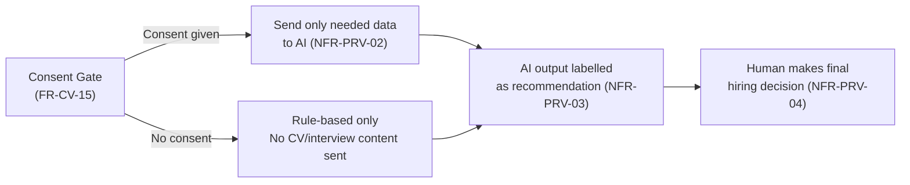

| ID | Requirement |
|---|---|
| NFR-PRV-01 | Obtain user consent before sending CV or interview content to the external AI service. |
| NFR-PRV-02 | Only data needed for the AI task is sent; passwords, tokens, and unrelated personal data are not sent. |
| NFR-PRV-03 | AI-generated content is labelled as a recommendation, not a guarantee. |
| NFR-PRV-04 | Consequential recruitment decisions are made by humans; AI scores do not trigger automatic rejection or selection. |
| NFR-PRV-05 | Points, streaks, and activity data are not visible to companies and not used in matching, ranking, or any hiring decision. |
| NFR-PRV-06 | Company hiring statistics shown only as aggregates, never as individual offers, and hidden when fewer than 3 hires exist. |

---

## 13. Technology Decisions and Rationale

| Decision | Choice | Rationale |
|---|---|---|
| Frontend | React + Vite SPA | Rich interactivity, large ecosystem, responsive SPA requirement (FR-UI-01) |
| Backend | Java 17 + Spring Boot | Mature, strong typing, excellent REST/security/JPA support, modular monolith pattern (NFR-MNT-01) |
| Database | MySQL 8.x | Relational integrity, foreign keys (DR-01), indexing for scalability (NFR-SCL-01) |
| ORM | Spring Data JPA / Hibernate | Parameterised queries prevent SQL injection (NFR-SEC-05); repository pattern (NFR-MNT-01) |
| Auth | JWT (stateless) + BCrypt + RBAC | Stateless backend scales horizontally (NFR-SCL-01); server-enforced RBAC (NFR-SEC-03) |
| AI integration | External AI provider via Spring AI / SDK | No custom model in MVP; AI is optional layer (NFR-REL-01) |
| Streaming | Server-Sent Events (SSE) | One-way server-to-browser streaming for long AI responses; fetch-based client for auth headers (NFR-PERF-04f) |
| CV parsing | Apache PDFBox or Apache Tika | Text extraction from PDFs (PDF-only in MVP per BR-07, TBD-05) |
| File storage | Outside web root, non-guessable names | Security: files not directly served (NFR-SEC-04, DR-02, DR-07) |
| Email | SMTP service | Company email verification in MVP (FR-ADM-09); other email deferred |
| API docs | OpenAPI / Swagger UI | All endpoints documented (NFR-MNT-02) |
| Schema migration | Versioned migration scripts | Controlled schema evolution (DR-06) |
| Architecture | Modular monolith (not microservices) | Simplicity for first release while preserving clean module boundaries (Section 2.5) |
